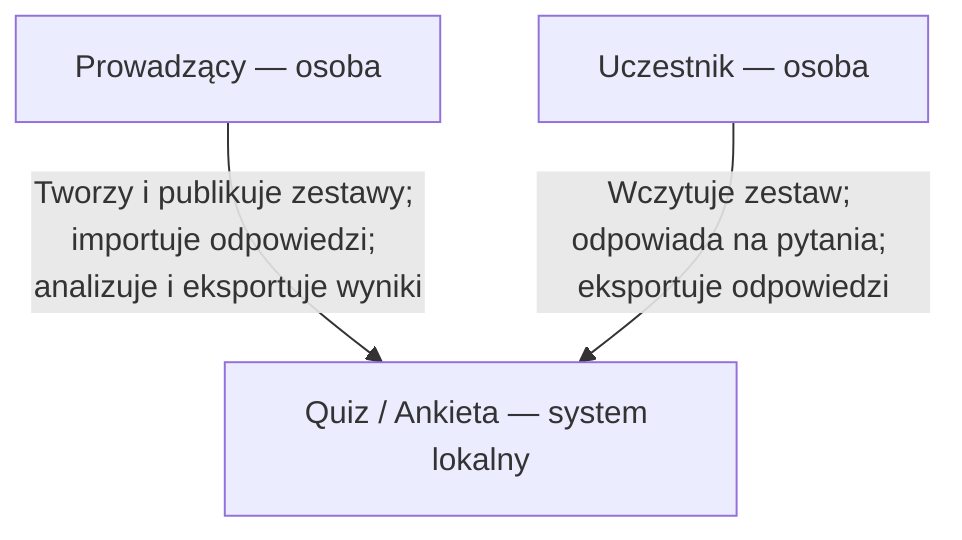
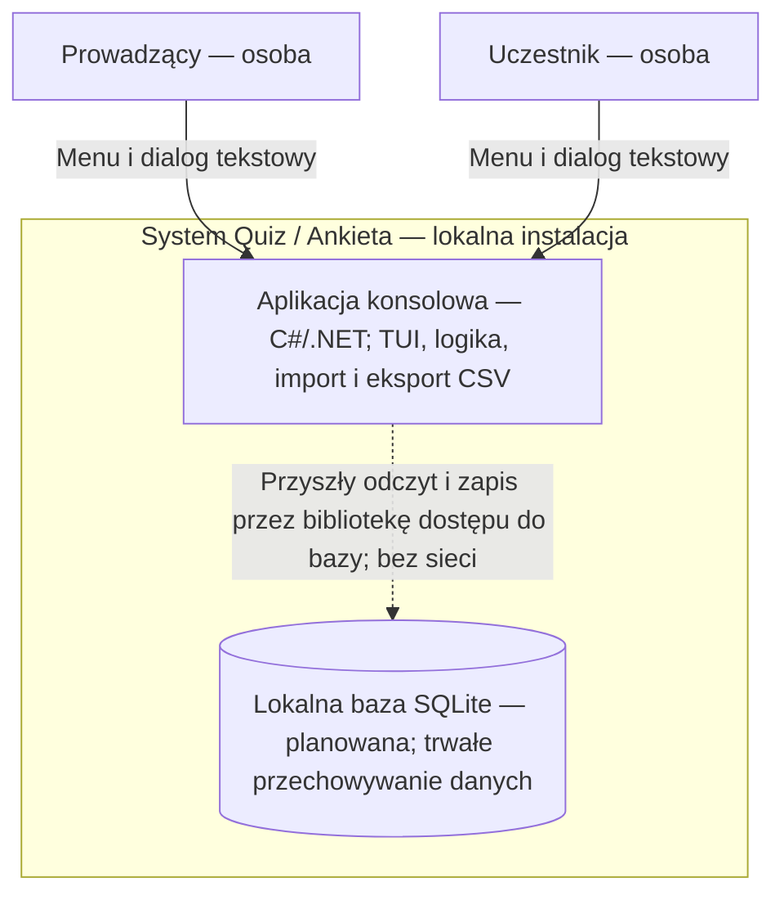

# Architektura aplikacji Quiz / Ankieta

## Status i zakres

Dokument przedstawia proponowaną architekturę aplikacji.
Wymaga przeglądu i uzgodnienia przez zespół.

Podstawą są [Architecture Drivers](architecture-drivers.md).
Funkcje i scenariusze opisano w [wymaganiach](requirements.md)
oraz [przypadkach użycia](use-cases.md).
Interfejs tekstowy i wymianę danych opisuje [kontrakt TUI](contract.md).

Diagramy pokazują docelowy zakres systemu. Nie oznaczają, że wszystkie
przedstawione funkcje zostały już zaimplementowane.

## Ograniczenia i założenia

- Aplikacja konsolowa w C#/.NET, z numerowanym menu i dialogami tekstowymi.
- Praca lokalna na Windows 11, bez konieczności dostępu do internetu.
- Jeden program dla prowadzącego i uczestnika.
- Brak kont, logowania i mechanizmu uprawnień.
- Brak centralnego serwera i współdzielenia danych online.
- Wymiana danych między komputerami przez pliki CSV.
- Pierwsza implementacja korzysta z pamięci operacyjnej.
- Trwały zapis w bazie danych zostanie dodany w kolejnym przyroście.
- SQLite jest propozycją bazy danych opisaną w ADR-001.

C#/.NET i praca offline są ograniczeniami projektu, a nie decyzjami
architektonicznymi podjętymi przez zespół.

## C4 L1 — kontekst systemu

Diagram przedstawia użytkowników i cały system jako jedną całość.
Role oznaczają wykonywane czynności, a nie konta z uprawnieniami.

Prowadzący i uczestnicy uruchamiają ten sam program lokalnie
na swoich komputerach. Diagram nie oznacza wspólnej instancji
aplikacji ani połączenia sieciowego między nimi.

Nie przewidujemy bezpośrednich integracji z zewnętrznymi systemami.

### Dane wymieniane przez CSV

CSV jest formatem danych, a nie zewnętrznym systemem.

| Dane | Przepływ |
|---|---|
| Opublikowany zestaw pytań | Prowadzący eksportuje, uczestnik wczytuje |
| Odpowiedzi uczestnika | Uczestnik eksportuje, prowadzący zbiera i importuje |
| Wyniki i statystyki | Prowadzący eksportuje do dalszej pracy w arkuszu |

Sposób fizycznego przekazywania plików pozostaje do uzgodnienia.
Aplikacja nie wysyła ich automatycznie między komputerami.

Excel lub inny arkusz może służyć do ręcznego otwarcia eksportu.
Nie projektujemy bezpośredniego połączenia aplikacji z Excelem.

Założenie do potwierdzenia: zestaw przekazywany uczestnikom nie zawiera
klucza poprawnych odpowiedzi. Klucz pozostaje u prowadzącego.

## C4 L2 — kontenery

W C4 kontener oznacza aplikację lub magazyn danych.
Nie oznacza tutaj kontenera Docker.

Diagram przedstawia planowaną strukturę jednej lokalnej instalacji.

Przerywana strzałka oznacza współpracę planowaną na kolejny przyrost.
Biblioteka dostępu do bazy nie została jeszcze wybrana.

SQLite działa lokalnie, bez osobnego procesu serwera.
Każda instalacja ma własne dane. Nie planujemy jednej wspólnej bazy
udostępnionej wszystkim uczestnikom.

| Element | Odpowiedzialność |
|---|---|
| Aplikacja konsolowa | Obsługa użytkownika, realizacja przypadków użycia, walidacja, obliczenia oraz import i eksport CSV |
| Planowana baza danych | Trwałe przechowywanie zestawów, pytań, opcji odpowiedzi i zapisanych odpowiedzi zgodnie z rozwijanym modelem danych |

## Pierwsza implementacja i dalszy rozwój

### Pierwszy przyrost — pamięć operacyjna

Wybrana mała funkcjonalność działa na obiektach i kolekcjach w pamięci
procesu aplikacji. Nie tworzymy jeszcze bazy danych ani migracji.

Dane przechowywane wyłącznie w pamięci znikają po zamknięciu programu.
Nie zakładamy, że pełny import i eksport CSV jest już dostępny
w pierwszym przyroście.

### Kolejny przyrost — trwały zapis

Po uzgodnieniu decyzji i modelu danych dodamy zapis oraz odczyt
z lokalnej bazy. Zapisane dane mają być dostępne po ponownym
uruchomieniu aplikacji.

Przed wdrożeniem trwałości ustalimy sposób zmiany schematu,
ochrony danych podczas aktualizacji i tworzenia kopii zapasowych.

## Odpowiedzialności wewnątrz aplikacji

Poniższe części są logicznym podziałem jednego programu.
Nie są oddzielnymi usługami ani kontenerami C4.

| Część | Odpowiedzialność |
|---|---|
| Interfejs tekstowy | Wyświetla menu, pobiera dane, pokazuje wyniki i zrozumiałe komunikaty błędów |
| Obsługa przypadków użycia | Steruje przebiegiem tworzenia, publikacji, rozwiązywania zestawu i importu odpowiedzi |
| Model i reguły | Reprezentuje zestawy, pytania i odpowiedzi; sprawdza poprawność operacji i niezmienność opublikowanej wersji |
| Dostęp do danych | Udostępnia dane logice aplikacji; początkowo korzysta z pamięci, później z bazy |
| Obsługa CSV | Odczytuje i zapisuje pliki według kontraktu, sprawdza ich strukturę i zgłasza błędy |

Interfejs wywołuje operacje aplikacji, a logika korzysta z modelu
i dostępu do danych. Obsługa menu nie powinna zawierać zapytań SQL.

Import musi sprawdzić strukturę pliku, identyfikator zestawu,
jego wersję oraz zgodność odpowiedzi. Zasady duplikatów wynikają
z uzgodnionych wymagań i kontraktu.

## Technologie

| Obszar | Technologia lub rozwiązanie | Status |
|---|---|---|
| Język i platforma | C#/.NET | Narzucone ograniczenie; wersję .NET uzgadniamy przy wspólnym szkielecie |
| Interfejs | Konsola, numerowane menu i dialog tekstowy | Wymaganie |
| Dane pierwszego przyrostu | Obiekty i kolekcje w pamięci | Ustalenie |
| Trwały zapis | SQLite | Propozycja w ADR-001 |
| Dostęp do bazy | Do wyboru; do rozważenia EF Core lub bezpośrednie SQL | Odrębna decyzja przed implementacją trwałego zapisu |
| Wymiana danych | CSV zgodnie z contract.md | Wymaganie; szczegóły formatu według kontraktu |

## Decyzje architektoniczne

- [ADR-001 — wybór SQLite jako lokalnej bazy danych](adr/ADR-001.md)

Wybór bazy danych i wybór sposobu dostępu do niej są odrębnymi
decyzjami. ADR-001 nie zatwierdza użycia Entity Framework Core.
