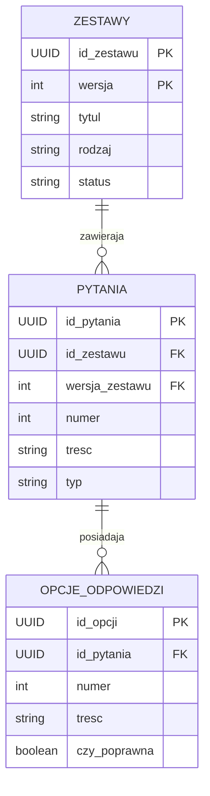

# Model danych — tworzenie i publikacja zestawu

## 1. Cel i zakres

Model dotyczy UC1: przygotowania i publikacji quizu lub ankiety.
Rozwija klasy Zestaw, Pytanie i OpcjaOdpowiedzi z modelu domenowego.

Dokument opisuje docelową relacyjną strukturę danych.
Pierwszy przyrost aplikacji korzysta nadal z pamięci operacyjnej.
Nie tworzymy teraz bazy ani migracji.

Powiązane dokumenty:
- [Model domenowy](design-domain-model.md)
- [Przypadki użycia](use-cases.md)
- [Wymagania](requirements.md)
- [Kontrakt interfejsu](contract.md)

## 2. Dane trwałe, tymczasowe i obliczane

### Dane wymagające zachowania po zamknięciu aplikacji

- Identyfikator, wersja, tytuł, rodzaj i status zestawu.
- Treści, typy i kolejność pytań.
- Treści i kolejność opcji odpowiedzi.
- Oznaczenia poprawnych opcji w quizie.

Klucz poprawnych odpowiedzi pozostaje częścią danych prowadzącego.
Plik zestawu przekazywany uczestnikom nie jest pełną kopią tych danych.

### Dane tymczasowe

- Aktualnie wybrana opcja menu.
- Wpisywana ścieżka pliku.
- Niezaakceptowany formularz pytania.
- Komunikat ostatniej operacji.

### Wartości obliczane

- Liczba pytań w zestawie.
- Liczba opcji w pytaniu.
- Informacja, czy zestaw spełnia warunki publikacji.

Nie zapisujemy ich jako osobnych kolumn, ponieważ wynikają z innych danych.

## 3. Założenia projektowe

- Zestaw ma identyfikator i numer wersji.
- Para identyfikator + wersja jednoznacznie wskazuje konkretny zestaw.
- Na początek tworzona jest wersja 1.
- Opublikowana wersja i jej zawartość są niezmienne.
- Możliwość tworzenia kolejnych wersji wymaga uzgodnienia.
- Pytania nie są współdzielone między zestawami.
- Opcje nie są współdzielone między pytaniami.
- Numeracja pytań i opcji zaczyna się od 1.
- Typy danych poniżej są logiczne; ich zapis w konkretnym silniku bazy
  doprecyzujemy przed implementacją.

## 4. Diagram ER

PK oznacza klucz główny, FK — klucz obcy.

W ZESTAWY klucz główny jest złożony z dwóch kolumn:
(id_zestawu, wersja).

W PYTANIA kolumny (id_zestawu, wersja_zestawu) tworzą jeden
złożony klucz obcy do ZESTAWY. Nie są dwoma niezależnymi powiązaniami.

Diagram pokazuje liczności strukturalne bazy: pytanie może chwilowo
nie mieć opcji w trakcie zapisu. Kompletne pytanie musi mieć minimum
dwie opcje. Regułę tę sprawdza logika aplikacji, a zapis kompletnego
pytania wraz z opcjami odbywa się w jednej transakcji.

## 5. Tabele i kolumny

### ZESTAWY

Przechowuje zestawy oraz ich wersje.

| Kolumna | Typ logiczny | Wymagana | Znaczenie |
| --- | --- | --- | --- |
| id_zestawu | UUID | Tak | Identyfikator zestawu |
| wersja | Liczba całkowita | Tak | Numer wersji większy od 0 |
| tytul | Tekst | Tak | Niepusty tytuł |
| rodzaj | Tekst | Tak | quiz albo ankieta |
| status | Tekst | Tak | roboczy albo opublikowany |

PK: (id_zestawu, wersja).

Tytuł nie musi być unikalny — dwa zestawy mogą mieć taką samą nazwę.

### PYTANIA

Przechowuje pytania konkretnej wersji zestawu.

| Kolumna | Typ logiczny | Wymagana | Znaczenie |
| --- | --- | --- | --- |
| id_pytania | UUID | Tak | PK pytania |
| id_zestawu | UUID | Tak | Część FK do zestawu |
| wersja_zestawu | Liczba całkowita | Tak | Część FK do zestawu |
| numer | Liczba całkowita | Tak | Kolejność pytania, od 1 |
| tresc | Tekst | Tak | Niepusta treść |
| typ | Tekst | Tak | jednokrotny albo wielokrotny |

FK: (id_zestawu, wersja_zestawu) → ZESTAWY(id_zestawu, wersja).

Unikalność: (id_zestawu, wersja_zestawu, numer).
W jednej wersji zestawu nie mogą wystąpić dwa pytania z tym samym numerem.

### OPCJE_ODPOWIEDZI

Przechowuje opcje przypisane do pytania.

| Kolumna | Typ logiczny | Wymagana | Znaczenie |
| --- | --- | --- | --- |
| id_opcji | UUID | Tak | PK opcji |
| id_pytania | UUID | Tak | FK do pytania |
| numer | Liczba całkowita | Tak | Numer opcji, od 1 |
| tresc | Tekst | Tak | Niepusta treść opcji |
| czy_poprawna | Wartość logiczna | Warunkowo | true/false dla quizu, NULL dla ankiety |

FK: id_pytania → PYTANIA(id_pytania).

Unikalność: (id_pytania, numer).

## 6. Relacje i spójność

### Relacje

- Jedna wersja zestawu ma zero lub wiele pytań.
- Każde pytanie należy do dokładnie jednej wersji zestawu.
- Każda opcja należy do dokładnie jednego pytania.
- Kompletne pytanie ma co najmniej dwie opcje.
- W tym fragmencie nie ma relacji wiele-do-wielu,
  więc tabela łącząca nie jest potrzebna.

### Ograniczenia zapewniane przez bazę

- PK: brak powtarzających się kluczy głównych.
- FK: brak pytania bez istniejącego zestawu
  oraz opcji bez istniejącego pytania.
- NOT NULL dla wymaganych kolumn.
- UNIQUE dla numerów pytań w wersji zestawu
  oraz numerów opcji w pytaniu.
- CHECK: dodatnie wersje i numery.
- CHECK: dozwolone wartości rodzaju, statusu i typu.
- CHECK: tytuł i treści nie mogą być puste ani zawierać tylko spacji.

Proponujemy blokadę usunięcia rekordu nadrzędnego, jeżeli ma rekordy
zależne (RESTRICT lub równoważne zachowanie wybranego silnika).
Nie włączamy automatycznego kaskadowego usuwania.

### Reguły sprawdzane przez aplikację

- Kompletne pytanie ma co najmniej dwie opcje.
- W quizie wszystkie opcje mają określone true albo false.
- Pytanie jednokrotnego wyboru w quizie ma dokładnie jedną poprawną opcję.
- Pytanie wielokrotnego wyboru w quizie ma co najmniej jedną poprawną opcję.
- W ankiecie czy_poprawna ma wartość NULL.
- Publikacja wymaga co najmniej jednego kompletnego pytania.
- Opublikowanego zestawu, jego pytań i opcji nie wolno zmieniać ani usuwać.

Reguły obejmujące wiele rekordów nie wynikają automatycznie
z samych kluczy PK i FK.

Publikacja musi w jednej transakcji sprawdzić kompletność
i zmienić status. Zapis pytania wraz z opcjami również ma być
niepodzielny: zapisujemy całość albo nic.

Szczegółowy sposób zabezpieczenia przed równoczesnymi zmianami
ustalimy przed implementacją trwałości danych.

## 7. Przykładowe rekordy

Dla czytelności identyfikatory UUID zastąpiono poniżej skrótami
Z1, Z2, P1, P2 oraz O1–O4. To oznaczenia przykładowe, nie prawidłowe UUID.

### ZESTAWY

| id_zestawu | wersja | tytul | rodzaj | status |
| --- | --- | --- | --- | --- |
| Z1 | 1 | Stolice | quiz | opublikowany |
| Z2 | 1 | Opinia o zajęciach | ankieta | roboczy |

### PYTANIA

| id_pytania | id_zestawu | wersja_zestawu | numer | tresc | typ |
| --- | --- | --- | --- | --- | --- |
| P1 | Z1 | 1 | 1 | Jaka jest stolica Polski? | jednokrotny |
| P2 | Z2 | 1 | 1 | Czy zajęcia były przydatne? | jednokrotny |

### OPCJE_ODPOWIEDZI

| id_opcji | id_pytania | numer | tresc | czy_poprawna |
| --- | --- | --- | --- | --- |
| O1 | P1 | 1 | Warszawa | true |
| O2 | P1 | 2 | Kraków | false |
| O3 | P2 | 1 | Tak | NULL |
| O4 | P2 | 2 | Nie | NULL |

### Prześledzenie poprawnych powiązań

- P1 wskazuje istniejący zestaw Z1 w wersji 1.
- P2 wskazuje istniejący zestaw Z2 w wersji 1.
- Wszystkie opcje wskazują istniejące pytania.
- Numery pytań i opcji są unikalne w swoich zakresach.
- P1 ma dwie opcje i dokładnie jedną poprawną.
- P2 ma dwie opcje, bez oceniania ich poprawności.
- Z1 spełnia opisane warunki publikacji.

Jest to sprawdzenie modelu na przykładach, nie test uruchomionej bazy.

## 8. Przypadki niepoprawne do sprawdzenia

| Próba | Oczekiwany wynik | Mechanizm |
| --- | --- | --- |
| Pytanie wskazuje nieistniejący Z9 | Odrzucenie | FK |
| Pytanie wskazuje Z1 w nieistniejącej wersji 2 | Odrzucenie | Złożony FK |
| Opcja wskazuje nieistniejące P9 | Odrzucenie | FK |
| Drugie pytanie nr 1 w Z1, wersji 1 | Odrzucenie | UNIQUE |
| Druga opcja nr 1 dla P1 | Odrzucenie | UNIQUE |
| Tytuł zawiera tylko spacje | Odrzucenie | Walidacja i CHECK |
| Publikacja zestawu bez pytań | Odmowa publikacji | Logika aplikacji |
| Zatwierdzenie pytania z jedną opcją | Odmowa zatwierdzenia | Logika aplikacji |
| Dwie poprawne opcje w quizie jednokrotnego wyboru | Odrzucenie | Logika aplikacji |
| Zmiana opcji w opublikowanym Z1 | Odrzucenie | Logika aplikacji |
| Usunięcie pytania mającego opcje | Odrzucenie | FK z blokadą usuwania |

## 9. Powiązanie z CSV

Struktura bazy i pliku CSV nie musi być taka sama.
Tabela poniżej odnosi się do proponowanego formatu zestawu
z kontraktu interfejsu. Przed scaleniem należy porównać ją
z aktualną wersją docs/contract.md.

| Pole CSV | Źródło w modelu |
| --- | --- |
| id_zestawu | ZESTAWY.id_zestawu |
| wersja | ZESTAWY.wersja |
| rodzaj | ZESTAWY.rodzaj |
| tytul | ZESTAWY.tytul |
| nr_pytania | PYTANIA.numer |
| tresc | PYTANIA.tresc |
| wybor | PYTANIA.typ |
| opcje | Treści opcji uporządkowane według OPCJE_ODPOWIEDZI.numer |

Jeden wiersz CSV opisuje pytanie wraz z jego opcjami.
W bazie każda opcja jest osobnym rekordem.

Eksport dla uczestnika:
- dotyczy opublikowanej wersji;
- zawiera pytania i opcje;
- nie zawiera kolumny czy_poprawna.

Import zestawu dla uczestnika nie pozwala odtworzyć klucza quizu.
Takiego importu nie można traktować jako pełnego odtworzenia
danych prowadzącego ani użyć samodzielnie do oceniania odpowiedzi.

Sposób przechowania/importu kopii prowadzącego z kluczem wymaga
doprecyzowania kontraktu. Nie definiujemy tutaj drugiego,
sprzecznego formatu CSV.

Separator, kodowanie, cytowanie pól i zapis list opcji określa
docs/contract.md. Jeżeli wymagają zmiany, aktualizujemy kontrakt
w tym samym uzgodnionym zakresie.

Pliki odpowiedzi uczestników i wyników dotyczą kolejnych
przypadków użycia. Nie projektujemy tutaj tabel tych funkcji.

## 10. Pytania i review zespołu

Do uzgodnienia:
- Czy prowadzący może tworzyć nowe wersje opublikowanego zestawu?
- Jak zachować i odtworzyć pełny zestaw z kluczem poprawnych odpowiedzi?
- Czy proponowane reguły walidacji są zgodne z ustaleniami sponsora?
- Czy model oraz mapowanie CSV odpowiadają aktualnemu kontraktowi?

Każdy członek zespołu powinien zaproponować i sprawdzić fragment modelu.
W komentarzu do Issue lub PR zapisuje sprawdzony zakres i wynik.
Wkład oraz wykonane review odnotowujemy dopiero po ich przeprowadzeniu.
