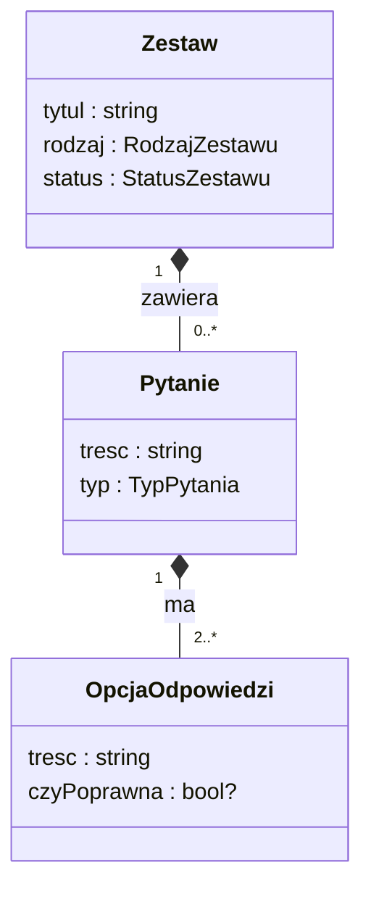

# Model domenowy — tworzenie i publikacja zestawu

Model dotyczy UC1: przygotowania i publikacji quizu lub ankiety.
Punktem odniesienia są powiązane wymagania US1 i kontrakt interfejsu.

## Diagram klas UML

## Znaczenie klas

- **Zestaw** — grupuje pytania i określa tytuł, rodzaj
  (quiz lub ankieta) oraz status (roboczy lub opublikowany).
- **Pytanie** — określa treść i typ wyboru:
  jednokrotny lub wielokrotny.
- **OpcjaOdpowiedzi** — przechowuje treść pojedynczej opcji.
  W quizie określamy jej poprawność.
  W ankiecie poprawność nie ma zastosowania (`null`).

## Relacje i liczności

- Zestaw zawiera od zera do wielu pytań.
  Zero jest dozwolone dla zestawu roboczego.
- Każde pytanie należy do jednego zestawu.
- Dodane pytanie ma co najmniej dwie opcje odpowiedzi.
- Każda opcja należy do jednego pytania.
- Kompozycja oznacza, że pytania są częściami zestawu,
  a opcje częściami pytania; nie współdzielimy ich między zestawami.

## Reguły

- Zestaw ma niepusty tytuł.
- Pytanie ma niepustą treść i co najmniej dwie niepuste opcje.
- Quiz jednokrotnego wyboru wymaga dokładnie jednej poprawnej opcji.
- Quiz wielokrotnego wyboru wymaga co najmniej jednej poprawnej opcji.
- Ankieta nie ocenia poprawności opcji.
- Publikacja wymaga co najmniej jednego kompletnego pytania.
- Opublikowana wersja zestawu jest niezmienna.

Szczegółowe reguły walidacji są propozycją do uzgodnienia.
Niezmienność opublikowanej wersji wynika z wizji produktu.

## Sprawdzenie na UC1

1. Utworzenie zestawu ustala jego tytuł i rodzaj.
2. Dodanie pytania ustala treść, typ i opcje odpowiedzi.
3. Dla quizu wskazywane są poprawne opcje.
4. Publikacja wymaga sprawdzenia kompletności zestawu
   i zmiany statusu na opublikowany.

Model nie obejmuje obsługi menu, zapisu CSV ani bazy danych.
To elementy techniczne poza zakresem modelu domenowego.
