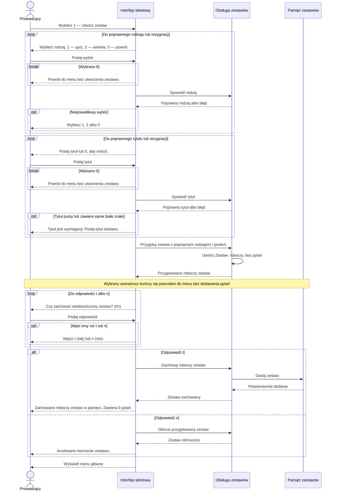

# Diagram sekwencji — utworzenie pustego zestawu

## Wybrany przypadek użycia i zakres

**UC1: Przygotuj i opublikuj zestaw** — kroki 1–3 oraz alternatywa
powrotu do menu z zachowaniem niedokończonego zestawu.

Diagram przedstawia jeden ograniczony scenariusz:
prowadzący wybiera tworzenie zestawu, podaje rodzaj i tytuł,
a następnie wraca do menu, decydując o zachowaniu wersji roboczej.

Nie przedstawiamy całego UC1. Dodawanie pytań i publikacja
należą do dalszej części przypadku użycia.

**Etap:** pierwsza implementacja z danymi w pamięci operacyjnej.
Nie zapisujemy danych do bazy ani pliku CSV.

**Warunek początkowy:** aplikacja wyświetla menu główne.

**Rezultat poprawny:** pusty, nieopublikowany zestaw znajduje się
w pamięci aplikacji, a użytkownik otrzymuje potwierdzenie.

## Uczestnicy interakcji

| Uczestnik | Odpowiedzialność |
| --- | --- |
| Prowadzący | Wybiera operację, podaje dane i decyduje o zachowaniu zestawu |
| Interfejs tekstowy | Wyświetla pytania i komunikaty, odczytuje wpisy |
| Obsługa zestawów | Sprawdza dane i steruje tworzeniem oraz zachowaniem zestawu |
| Pamięć zestawów | Przechowuje utworzone zestawy przez czas działania programu |

„Obsługa zestawów” realizuje odpowiedzialność obsługi przypadków użycia,
a „Pamięć zestawów” jest wariantem dostępu do danych opisanym
w architekturze. Są to proponowane nazwy elementów współpracy,
nie deklaracja już istniejących klas C#.

Tworzonym obiektem domenowym jest `Zestaw`.
Nie powstają jeszcze obiekty `Pytanie` ani `OpcjaOdpowiedzi`.

## Diagram sekwencji UML

## Reguły i wynik

- Rodzaj zestawu to `quiz` albo `ankieta`.
- Tytuł nie może być pusty ani składać się wyłącznie z białych znaków.
- Błędny wpis powoduje ponowienie pytania, bez dodawania zestawu do pamięci.
- Zestaw jest przygotowywany dopiero po otrzymaniu poprawnych danych.
- Dopiero potwierdzenie `t` dodaje zestaw do kolekcji przechowywanych zestawów.
- Odpowiedź `n` odrzuca przygotowany obiekt.
- Zachowany zestaw ma stan roboczy, czyli nieopublikowany, i zero pytań.
- Pustego zestawu nie można opublikować; publikacja jest poza tym diagramem.
- Zachowanie w pamięci nie zapewnia trwałości po zamknięciu programu.

## Spójność z pozostałymi dokumentami

| Dokument | Powiązanie |
| --- | --- |
| [Przypadki użycia](use-cases.md) | UC1, kroki 1–3 i alternatywa zachowania niedokończonego zestawu |
| [Kontrakt TUI](contract.md) | Operacja 1, wybór rodzaju, tytuł, błędy i potwierdzenie zachowania |
| [Model domenowy](design-domain-model.md) | Obiekt Zestaw, rodzaj, tytuł i stan roboczy; brak pytań jest dopuszczalny przed publikacją |
| [Model danych](data-model.md) | Informacje o zestawie; bez tworzenia rekordów w bazie na tym etapie |
| [Architektura](architecture.md) | Interfejs, obsługa przypadków użycia i dostęp do danych w pamięci |
| [Wymagania](requirements.md) | Fragment realizacji US1; diagram nie pokrywa całej historyjki |

Jeżeli dokumenty modeli są jeszcze w otwartych PR-ach,
spójność należy sprawdzić z ich proponowanymi wersjami.
Odnośniki zaczną działać na main po scaleniu odpowiednich zmian.

## Doprecyzowania do uzgodnienia przez zespół

- Dokładne komunikaty dla operacji 1 stanowią propozycję uzupełnienia TUI.
- Wpis `0` przy tytule oznacza rezygnację; tytuł równy dokładnie `0`
  jest zatem zarezerwowany i wymaga akceptacji zespołu.
- Przed podaniem poprawnego rodzaju i tytułu nie istnieje jeszcze poprawny
  zestaw do zachowania, dlatego rezygnacja nie powoduje pytania o zapis.
- Pierwszy przyrost kończy się zachowaniem albo odrzuceniem pustego zestawu.
  Dalsze kroki UC1, w tym dodawanie pytań, zostaną dodane później.
- Identyfikator i początkową wersję zestawu należy uzgodnić z modelem danych
  przed implementacją; diagram nie narzuca sposobu ich generowania.

## Przykłady do sprawdzenia podczas review

| Przebieg | Oczekiwany wynik |
| --- | --- |
| Rodzaj 1, tytuł „Stolice”, potwierdzenie t | Jeden roboczy quiz bez pytań w pamięci |
| Rodzaj 2, tytuł „Opinia”, potwierdzenie t | Jedna robocza ankieta bez pytań w pamięci |
| Rodzaj 7, następnie 1 | Komunikat błędu, ponowienie pytania, brak niepoprawnego zestawu |
| Pusty tytuł, następnie poprawny | Ponowienie pytania o tytuł |
| Wpis 0 przy rodzaju lub tytule | Powrót do menu, bez dodania zestawu |
| Poprawne dane i odpowiedź n | Zestaw odrzucony |
| Odpowiedź x przy potwierdzeniu | Ponowienie pytania t/n, bez dodania zestawu |

Powyższe przykłady służą do sprawdzenia projektu.
Nie są raportem z wykonanych testów aplikacji.
